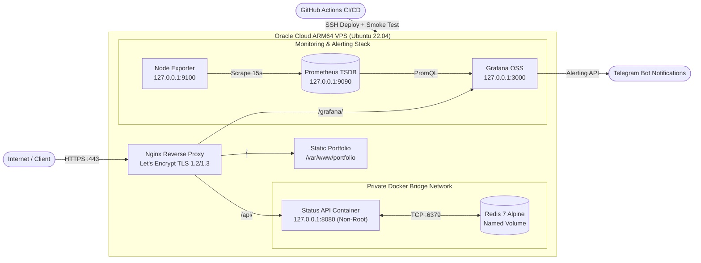

# Cloud Infrastructure & DevOps Automation Lab

[](https://github.com/gareznik/cloud-lab-status-api/actions/workflows/deploy.yml)
[](LICENSE)
[-orange.svg)]()

A production-grade cloud infrastructure and containerized microservice lab deployed on **Oracle Cloud Infrastructure (ARM64 / Ubuntu 22.04)**. This project demonstrates end-to-end DevOps practices: Linux security hardening, TLS-terminating L7 reverse proxying, full-stack observability with real-time alerting, idempotent configuration management, and automated CI/CD pipelines.

---

## Live Endpoints

| Service | Public HTTPS Endpoint | Internal Binding | Description |
| :--- | :--- | :--- | :--- |
| **Landing Page** | `https://gareznik-lab.duckdns.org/` | `/var/www/portfolio` | Static web root served directly by Nginx |
| **Status API** | `https://gareznik-lab.duckdns.org/api/` | `127.0.0.1:8080` | Containerized Python Flask + Redis microservice |
| **Monitoring UI** | `https://gareznik-lab.duckdns.org/grafana/` | `127.0.0.1:3000` | Grafana dashboards behind WebSocket-enabled proxy |

---

## System Architecture



---

## Key Engineering & Security Highlights

* **Zero-Trust Network Exposure:** All internal services (Prometheus, Grafana, Docker containers) are bound strictly to `127.0.0.1`. This prevents Docker's `iptables` `DNAT` rules from bypassing `UFW` and leaves Nginx (`:443`) as the sole public ingress point.
* **Linux Hardening & L3/L4 Troubleshooting:** Configured key-based SSH authentication, `sudo` privilege separation, Fail2ban IPS, stateful `UFW` rules, and resolved Oracle Cloud pre-seeded `iptables` `REJECT` conflicts.
* **Automated TLS Lifecycle:** Provisioned X.509 certificates via Let's Encrypt (`Certbot` ACME HTTP-01 challenge) with automated 90-day renewal managed by `systemd` timers and enforced `301` HTTP-to-HTTPS redirection.
* **Container Security & Persistence:** Built a multi-container stack (`Flask` + `Redis`) running under a dedicated unprivileged container user (`appuser`), isolated inside a custom bridge network with persistent `redis-data` volume storage.
* **Observability & Anti-Flapping Alerting:** Implemented PromQL CPU utilization alerts (`rate(node_cpu_seconds_total{mode="idle"}[1m])`) with a 1-minute `Pending` evaluation window to eliminate false positives, integrated with Telegram Bot API (`FIRING` / `RESOLVED` lifecycle validated via `stress-ng`).
* **Idempotent Configuration Management (IaC):** Managed host packages, `systemd` services, restricted `.env` secrets (`0640`), and Docker Compose reconciliation via Ansible Playbooks (`changed=0` convergence).
* **Zero-Touch CI/CD Pipeline:** Automated Python syntax checks, Compose config validation, SSH deployment via scoped GitHub Secrets, dangling image cleanup (`docker image prune`), and post-deploy HTTPS smoke tests via GitHub Actions.

---

## Sample API Response

```json
{
  "architecture": "aarch64",
  "container_id": "d153021a15c1",
  "deployed_via": "GitHub Actions CI/CD",
  "environment": "production",
  "service": "cloud-lab-status-api",
  "status": "healthy",
  "total_requests": 9,
  "version": "1.1.0"
}
```

---

## Repository Structure

```text
.
├── .github/
│   └── workflows/
│       └── deploy.yml       # CI validation, SSH deployment & HTTPS smoke test
├── app.py                   # Flask microservice with Redis hit counter
├── Dockerfile               # Hardened slim image with non-root user
├── docker-compose.yml       # Multi-container orchestration & network isolation
├── requirements.txt         # Python dependencies
├── .env.example             # Environment variable template
├── .gitignore               # Excludes host-managed .env secrets
└── LICENSE                  # MIT License
```

---

## Local Development

```bash
# 1. Clone the repository
git clone [https://github.com/](https://github.com/)gareznik/cloud-lab-status-api.git
cd cloud-lab-status-api

# 2. Create environment configuration
cp .env.example .env

# 3. Build and start containers
docker compose up -d --build

# 4. Verify endpoint
curl -s [http://127.0.0.1:8080/](http://127.0.0.1:8080/)
```

---

## License

This project is licensed under the MIT License — see the [LICENSE](LICENSE) file for details.
